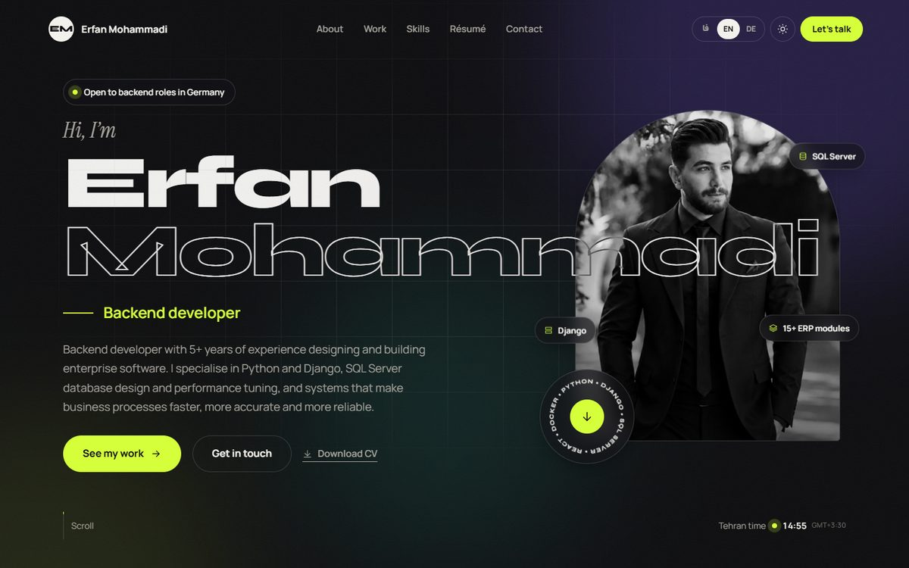
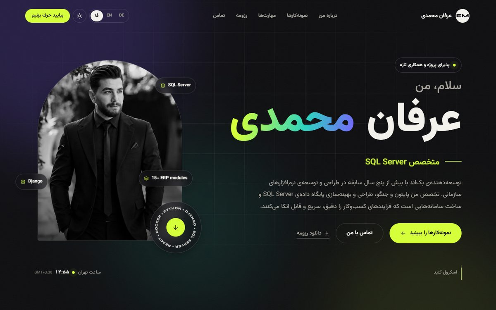
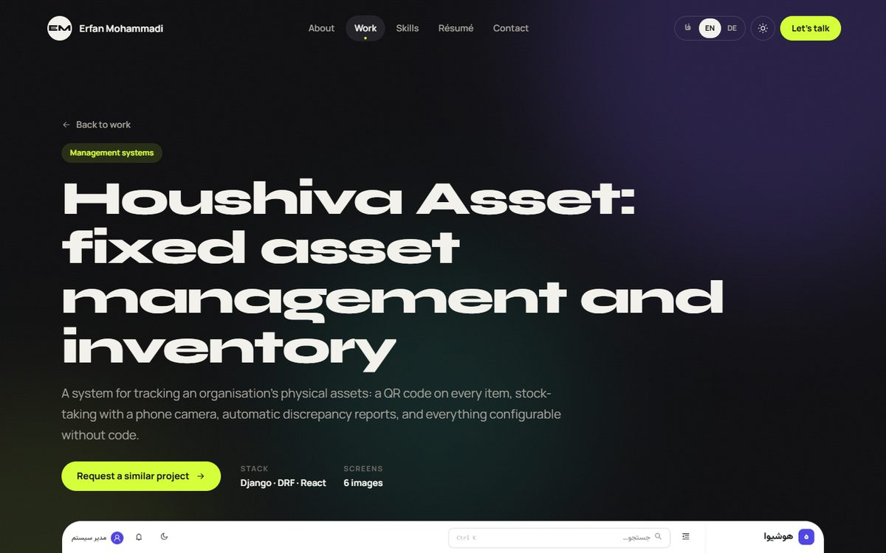
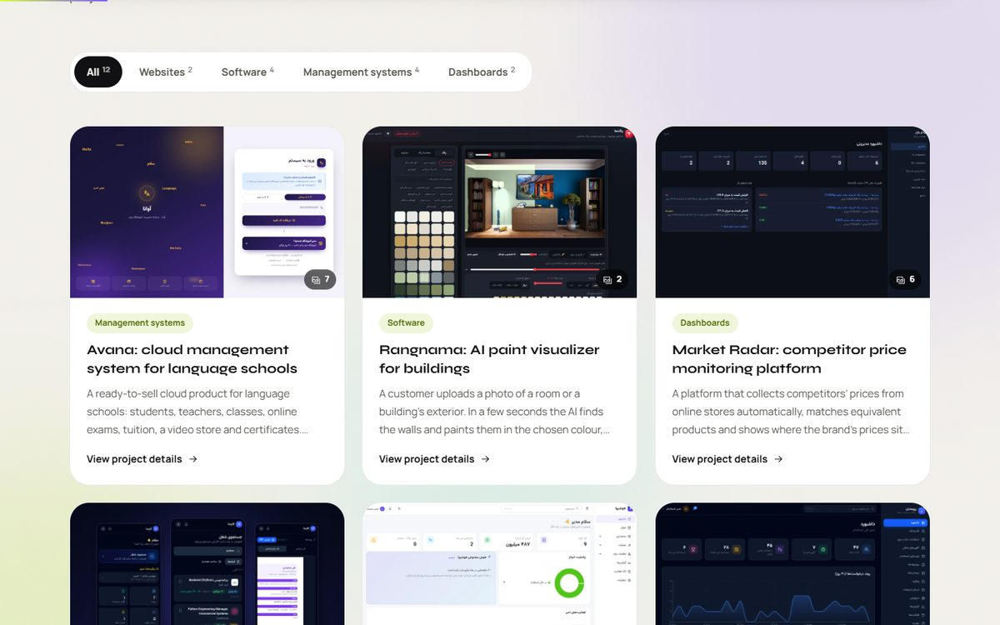
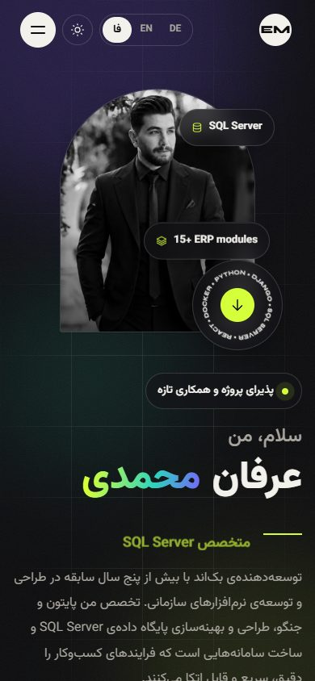
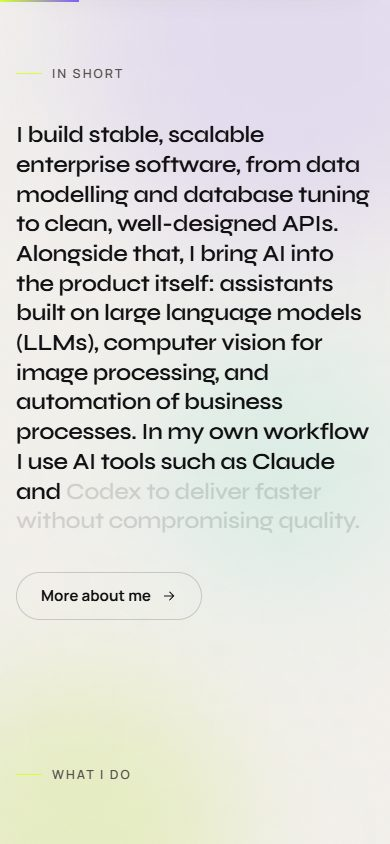

<div align="center">

# Erfan Mohammadi · Portfolio

**Python / Django backend developer and Microsoft SQL Server specialist.**
Personal portfolio, résumé and project showcase, in Persian, English and German.

[](https://erfanmohammadi.ir)
[](https://github.com/erfanmohammadi1998/portfolio/actions/workflows/deploy.yml)
[](https://react.dev)
[](https://vitejs.dev)

[فارسی](https://erfanmohammadi.ir/fa/) · [English](https://erfanmohammadi.ir/en/) · [Deutsch](https://erfanmohammadi.ir/de/)



</div>

## About

This repository is the source of [erfanmohammadi.ir](https://erfanmohammadi.ir), the personal site of
**Erfan Mohammadi (عرفان محمدی)**, a backend developer from Tehran with 5+ years of experience
building enterprise software: ERP modules, REST APIs, SQL Server databases and AI features.

The site presents:

- **Work**: twelve delivered projects (management systems, SaaS products, dashboards, AI tools),
  each with a full case study: problem, solution, how it was built, features, result and screenshots.
- **About & résumé**: experience, education, training and languages, with a print-ready web CV and
  downloadable PDFs in English and German.
- **Skills**: proficiency levels taken straight from the CV, plus a chart of the technologies that
  actually appear across the projects.

## Screenshots

| Persian (RTL) | Project page | Projects, light theme |
|---|---|---|
|  |  |  |

| Mobile, Persian | Mobile, English light |
|---|---|
|  |  |

## Highlights

**Design and motion**
- Monochrome editorial look with one lime accent; dark theme by default and a light theme that
  switches with a circular reveal (View Transitions API).
- Smooth scrolling (Lenis), a short multilingual intro, page-curtain transitions, word-by-word
  heading reveals, scroll-lit text, count-up stats, crossing marquee bands and a pinned
  horizontal "selected work" section that becomes a swipe row on phones.
- A custom cursor (exact dot plus trailing ring with contextual labels) on mouse devices only.
- Fully responsive and right-to-left aware; `prefers-reduced-motion` turns the motion off.

**SEO and performance**
- Every route is **prerendered to static HTML at build time** (React `renderToString` +
  `StaticRouter`), so search engines and link previews get real content and GitHub Pages answers
  each URL with `200` instead of the usual single-page-app 404 trick.
- Unique title and description per page and language, canonical URLs, `hreflang` alternates
  (fa / en / de / x-default), Open Graph and Twitter cards with 1200×630 preview images.
- JSON-LD structured data: `Person`, `WebSite`, `ProfilePage`, `CollectionPage` + `ItemList`,
  `CreativeWork` for each project, `ContactPage` and `BreadcrumbList`.
- Generated `sitemap.xml` with hreflang alternates and image entries, `robots.txt`, real `404.html`
  with `noindex`, web app manifest and touch icons.
- Self-hosted variable fonts (Google Fonts is unreachable for many visitors in Iran), lazy images
  with explicit dimensions, and a preloaded hero portrait.

## Tech stack

| Area | Tools |
|---|---|
| UI | React 18, React Router 6 |
| Build | Vite 5, a small SSR prerender step (`scripts/prerender.mjs`) |
| Styling | One hand-written CSS file with CSS variables (no framework) |
| Motion | CSS animations, IntersectionObserver, Lenis |
| Fonts | Vazirmatn, Manrope, Syne, Instrument Serif via `@fontsource` |
| Hosting | GitHub Pages + GitHub Actions, custom domain |

## Getting started

```bash
npm install
npm run dev       # dev server at http://localhost:5173
npm run build     # client build + SSR build + prerender into dist/
npm run preview   # serve the production build locally
```

`npm run build` runs three steps:

1. `vite build`: the client bundle.
2. `vite build --ssr src/entry-server.jsx --outDir dist-ssr`: a server bundle used only at build time.
3. `node scripts/prerender.mjs`: writes `dist/<lang>/<path>/index.html` for every route,
   plus `404.html`, the root redirect and `sitemap.xml`.

## Project structure

```
src/
  pages/          Home, About, Projects, ProjectDetail, Skills, Resume, Contact, NotFound
  components/     Navbar, Footer, Preloader, Cursor, HorizontalWork, ProjectCard, Lightbox,
                  Marquee, WordReveal, SplitWords, Counter, CtaBlock, …
  data/           profile.js, resume.js, services.js,
                  projects.js (+ projects.fa.js / .en.js / .de.js for the copy)
  i18n/           translations.js (all UI text) and LanguageContext (t / tx / num / to)
  styles/         global.css
  seo.js          titles, descriptions, canonical/hreflang, Open Graph, JSON-LD
  entry-server.jsx  server entry for prerendering
  theme.jsx       dark / light theme provider
  smooth.js       Lenis smooth scrolling (desktop only)
scripts/
  prerender.mjs   static HTML, 404, root redirect and sitemap
public/
  portfolio/      project screenshots
  og/             link-preview images (per language and per project)
  cv/             downloadable CVs (EN, DE)
docs/screenshots/ images used in this README
```

## Editing content

| What | Where |
|---|---|
| Name, contact details, links, CV files | `src/data/profile.js` |
| Projects: list, order, category, images, tech | `src/data/projects.js` |
| Project text per language | `src/data/projects.fa.js`, `projects.en.js`, `projects.de.js` |
| Experience, education, training, skills, languages | `src/data/resume.js` |
| "What I do" cards and process steps | `src/data/services.js` |
| Interface text | `src/i18n/translations.js` |
| Page titles, descriptions, structured data | `src/seo.js` |

New projects, pages and languages are picked up by the prerender step and the sitemap automatically.

## Routing and languages

Every page lives under a language prefix: `/fa/` (default, right-to-left), `/en/` and `/de/`,
for example `/en/projects/houshiva-asset/`. The bare domain redirects to `/fa/`. Internal links
use trailing slashes, which is exactly what GitHub Pages serves for the prerendered folders.

## Deployment

`.github/workflows/deploy.yml` builds and publishes to GitHub Pages on every push to `main`.
The custom domain comes from `public/CNAME` (`erfanmohammadi.ir`).
One-time setup: **Settings → Pages → Source → GitHub Actions**.

## Contact

- Website: [erfanmohammadi.ir](https://erfanmohammadi.ir)
- Email: [erfan.mohammadi.alv77@gmail.com](mailto:erfan.mohammadi.alv77@gmail.com)
- LinkedIn: [linkedin.com/in/erfan-mohammadi77](https://www.linkedin.com/in/erfan-mohammadi77/)
- Studio: [houshiva.ir](https://houshiva.ir)

<sub>© Erfan Mohammadi. The code is shared for reference; the content, photos and project
screenshots are not licensed for reuse.</sub>
